Run comparison puts the results of several model runs side by side. Open the **Model Hub**,
then select **Tools** > **Compare Runs...** on the ribbon. Pick a model, add its runs from
the history list, and add workspace tables, such as measured data, if you need them. The
tool matches the values of all runs by name, and you pick what to chart.

## Comparing a value

The **Compare** list shows every value that at least two runs share, with its units and how
many runs have it (`3/3`). The badge says how its names matched: **exact**, **normalized**
(ignoring case and separators), or **fuzzy**. Values in different units never match. Click a
value to chart it: a scalar charts as one bar per run.

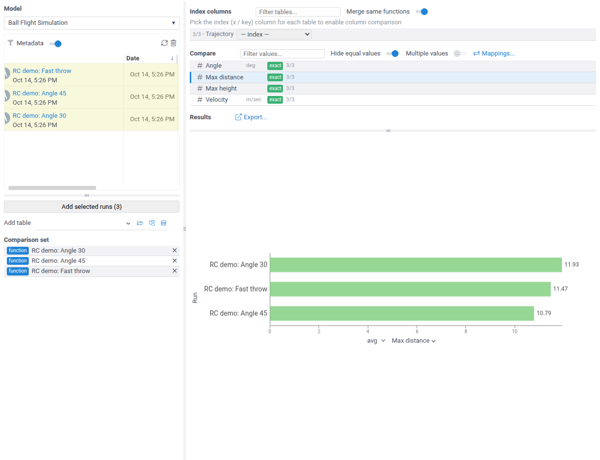

## Comparing several values

Turn on **Multiple values**, or Shift+click a second value, to chart several scalars at once.
Three or more values chart on a radar chart, one polygon per run, and the switch above the
chart flips it to a parallel coordinates plot. Two values always use the parallel
coordinates plot.

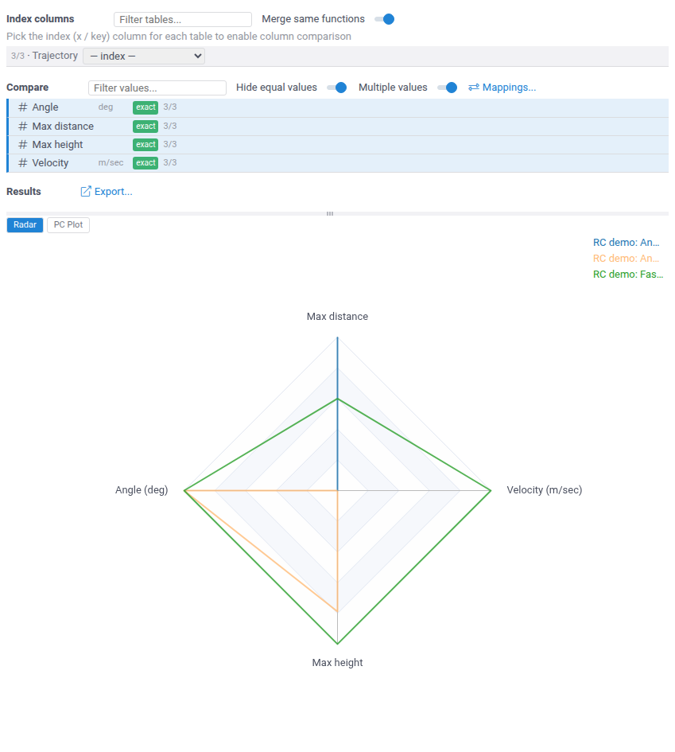

## Comparing series

To compare dataframe outputs, pick their index column under **Index columns**: the x axis
of the chart. The columns of that table then appear in the **Compare** list, and a column
charts as one line per run. With **Merge same functions** on, one pick covers the same
output of all runs.

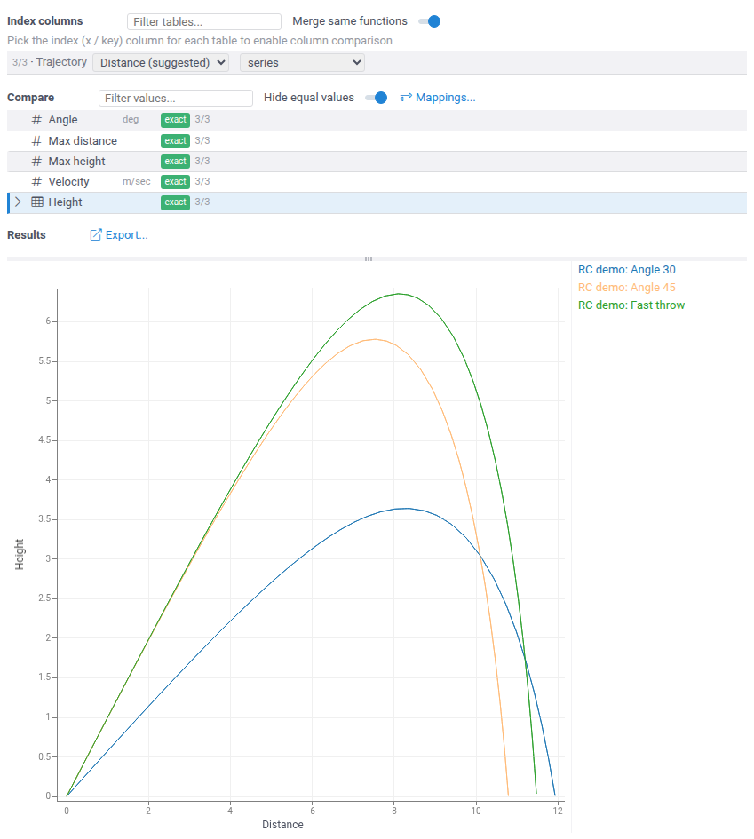

## Comparing workflows

Runs of a [workflow](workflows/overview.mdx) are compared step by step. A value of a step
that repeats, such as one cultivation step per day, gets one row per occurrence, labeled
with its step, and runs pair by step: day 2 of one run is compared with day 2 of the
others.

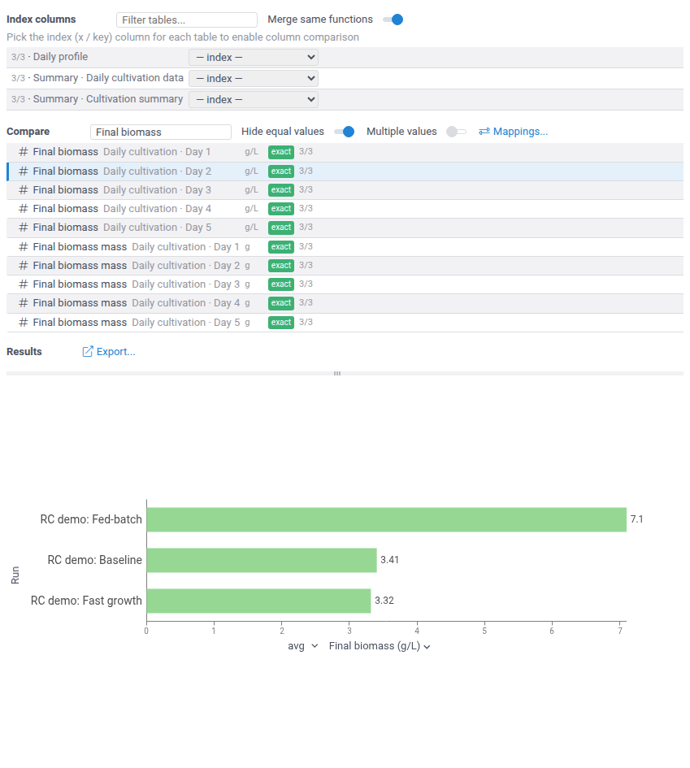

## Different run lengths

When runs have different numbers of steps, a row covers only the runs that have that
step, and its count shows it (`4/5`). Under **Results**, a red chip names each run left
out of the chart and the reason.

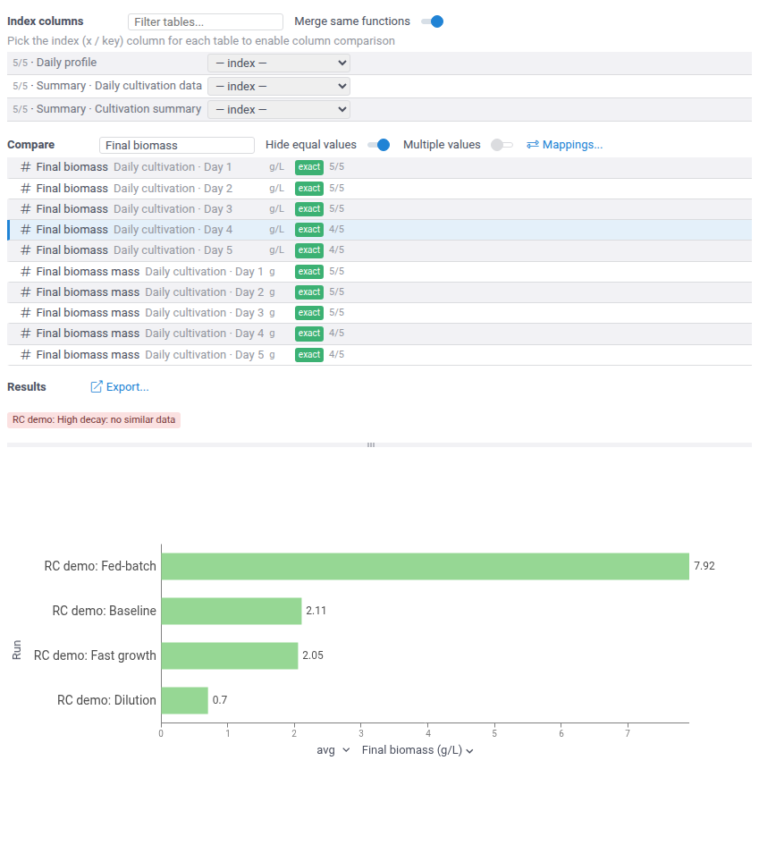

## Several steps

With **Multiple values** on, you can chart columns from different steps together: each
step of a run is its own line. When all the values have the same units, they share one
panel and one y axis. Turn off **Shared y axis** above the chart to give each value its own
panel, for example when their magnitudes differ too much.

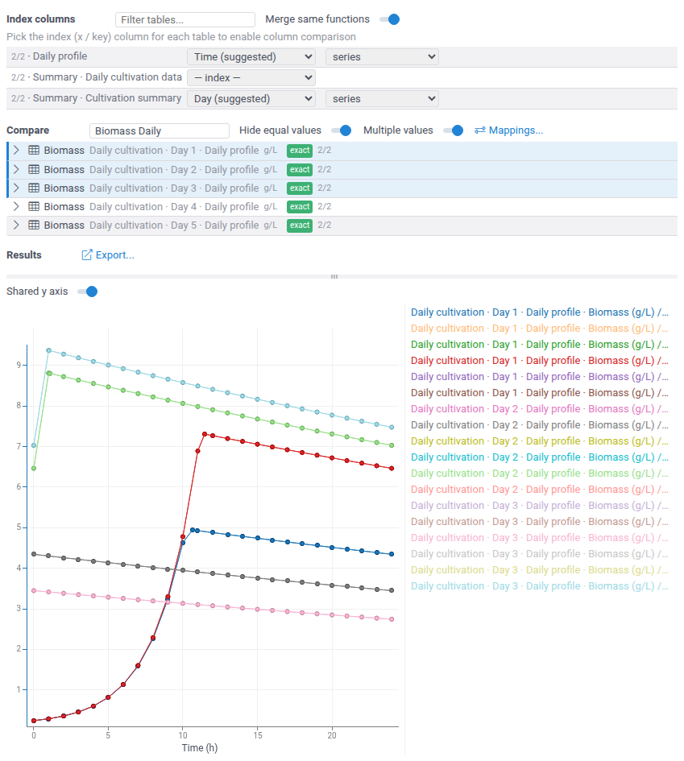

## Step summaries

A workflow that collects its steps into a summary table can be compared on it: pick the
step number (here `Day`) as the index, and each run becomes one line through its steps.
Runs of different lengths simply end at different points.

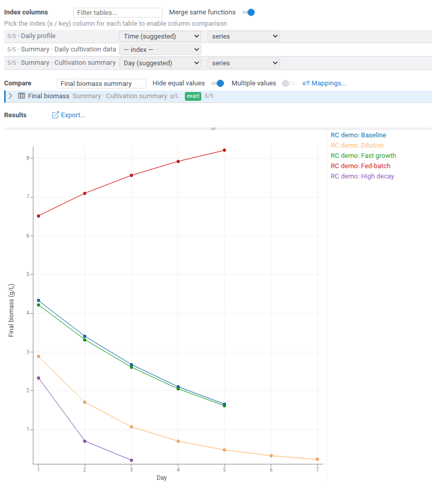

## Hiding equal values

**Hide equal values** is on by default. It removes the values that are the same in all
runs, such as inputs nobody changed, so the list shows only what differs. A charted value
stays in the list.

## Adding measured data

Tables in the workspace, such as measured data loaded from a file, can join the
comparison: add them under **Add table**, and pick their index the same way. A column
joins every row with the same name. A string column of the table can be picked as its
split column, to chart each category, such as each reactor, as a separate line. Tables
usually carry no units: an info icon marks rows where such a table is taken to be in the
row's units.

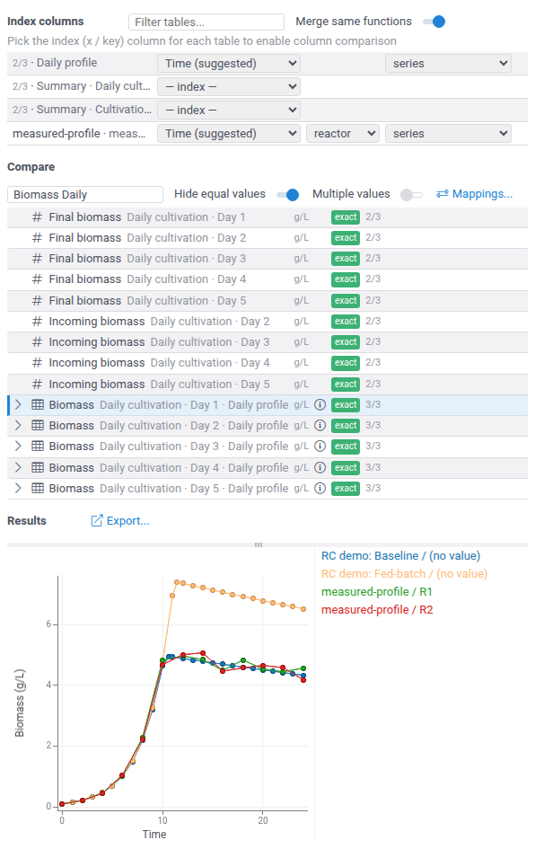

## Aligning time axes

When tables record time differently, for example model hours and lab timestamps, set the
index to **relative timeseries** on each of them. Every table then starts at zero, and the
chart uses one elapsed-time axis. For a numeric index, the picker next to it sets its time
units. Here the lab log's `timestamp` index was also mapped to `Time`
([names and units](#names-and-units)), because index columns of different names never match.

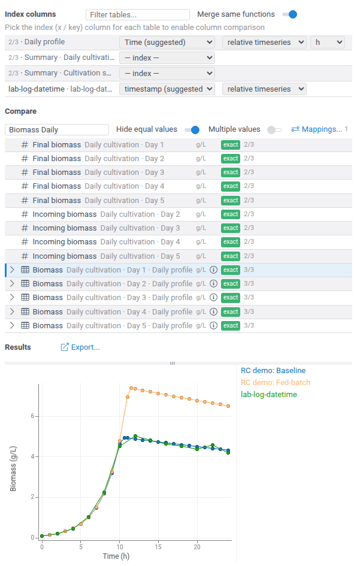

## Scattered samples

Data without a meaningful order, such as samples taken at random points, charts better as
points. Set the index to **independent points** on each table: the chart becomes a
scatterplot. Any numeric column can be the index, so this also gives value-vs-value views,
here biomass against substrate.

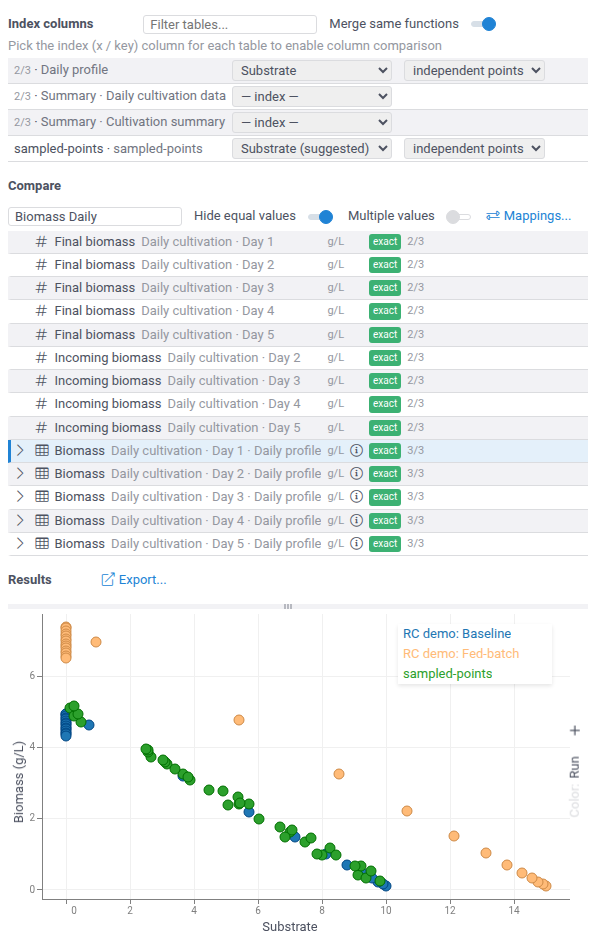

## Names and units

When runs or tables name the same value differently, or use other units, open
**Mappings...**. The dialog lists the values that are in no compare row, with their units
and the number of runs that have them. **Map name** and **Map units** start a mapping from
a listed value. Name mappings work for index columns too. A unit mapping, such as
`1 g/L = 1000 mg/L`, works in both directions and converts the values when the chart is
built.

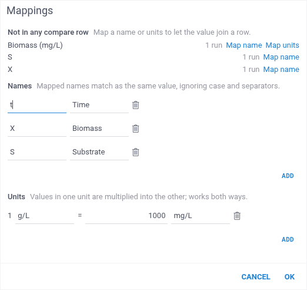

## Fixing a match

Matching picks one item per run for each row, which isn't always the one you need. Expand
the row with its chevron to see every compatible item, grouped by run:

* the items matching picked are checked and marked **(auto)**;
* checking another item makes it the run's item and unchecks the previous one;
* unchecking an item leaves the run out of the chart;
* **Reset to auto** discards your changes for that row.

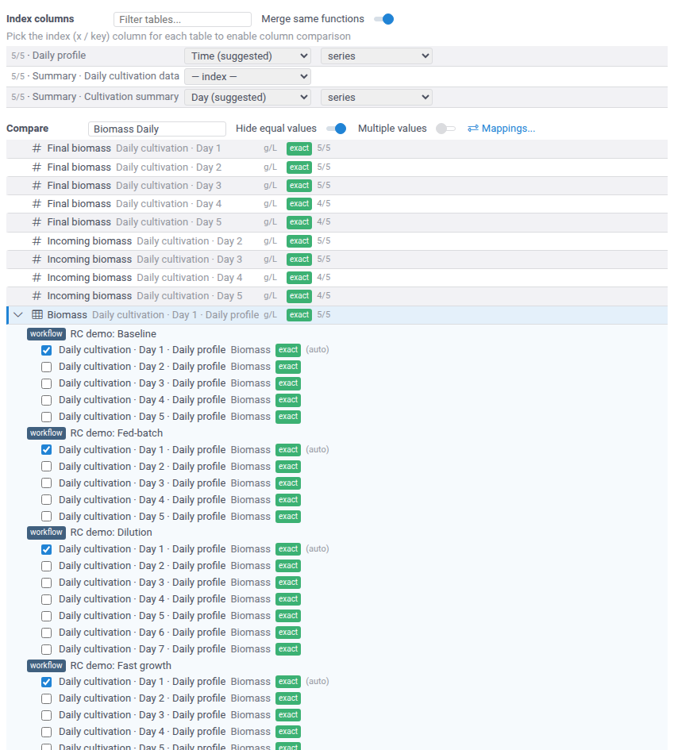

## Exporting

**Export...** under **Results** saves a snapshot of the comparison: the chart data and the
chart. **Open in workspace** opens it as a table with the chart, for any further analysis.
**Save & share** saves it as a project.

## Index annotations

A model can set the index for its dataframe outputs, so that users don't have to pick it.
Add the `comparison` option to the output:

```javascript
//output: dataframe profile {comparison: {"index": "Time", "split": "reactor", "mode": "timeseries", "units": "h"}}
```

All keys are optional. `index` and `split` name columns of the output. `mode` is
`series`, `timeseries` (relative timeseries), or `points` (independent points), and
`units` (`ms`, `s`, `min`, `h`, or `days`) sets the time units of a numeric index in the
`timeseries` mode. The annotations only fill in what the user hasn't picked yet.
